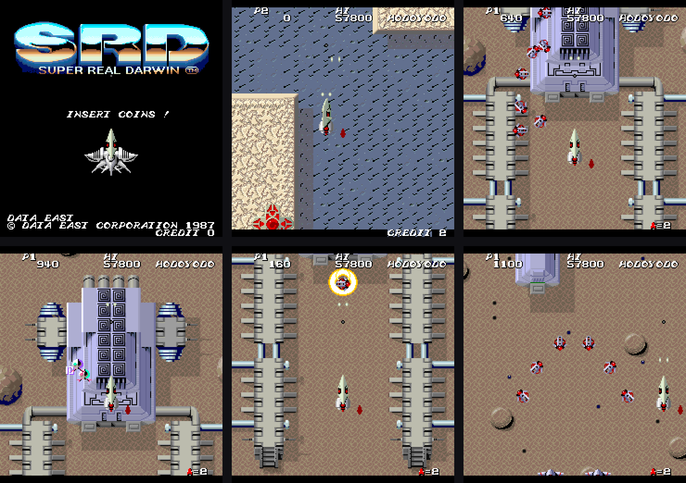
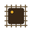

# Super Real Darwin for MiSTer

Data East's 1987 vertical arcade shooter **Super Real Darwin**, rebuilt from scratch for the MiSTer FPGA. World and Japan versions (one MRA each), a sharp rotated picture on a CRT or HDMI, and separate volume controls for the music and the effects.

> Release 1.0.0. Tested on real MiSTer hardware: both versions boot and play with sound; the picture matches MAME pixel for pixel.

*The title screen and stage 1, as drawn by this core (upright, scaled 2x). Super Real Darwin and its artwork are Data East's.*

## At a glance

| &nbsp;&nbsp;&nbsp;&nbsp;&nbsp;&nbsp;&nbsp;&nbsp;&nbsp;&nbsp;&nbsp;&nbsp;&nbsp;&nbsp;&nbsp;&nbsp;&nbsp;&nbsp; | | |
|:-:|---|---|
|  | **Versions** | Super Real Darwin (World) and Super Real Darwin (Japan), each with its own MRA. Load the other MRA to change version |
|  | **Players** | 1 or 2. Each pad has its own controls, mapped in MiSTer's Define joystick buttons |
|  | **Picture** | HDMI (rotated for a normal TV) and analog CRT (rotated, sized and smoothed from the OSD, or the raw sideways 15 kHz picture for a monitor on its side) |
|  | **Sound** | YM2203 and YM3812, with a volume for each, a master volume and a Treble option |
|  | **Service Mode** | An OSD switch that restarts the game into its test mode |

## Controls

The core uses the MiSTer controller mapping (Button 1, Button 2, Start, Coin). Map your pad in MiSTer's own **Define joystick buttons** (System menu, press Right on the main menu), then use the OSD button to leave the screen. A second pad of the same model shares the mapping.

| &nbsp;&nbsp;&nbsp;&nbsp;&nbsp;&nbsp;&nbsp;&nbsp;&nbsp;&nbsp;&nbsp;&nbsp;&nbsp;&nbsp;&nbsp;&nbsp;&nbsp;&nbsp; | | |
|:-:|---|---|
|  | **Coins and starts** | **5** and **6** coin 1 and 2, **1** and **2** start 1 and 2 |
|  | **Move** | The arrow keys |
|  | **Fire** | **Left Ctrl** is Button 1, **Left Alt** is Button 2 |

## The OSD at a glance

Open the OSD with the button on your controller or **F12** on a keyboard. The first choice of every option is the factory setting. The game reads its DIP switches when it starts, so changing any DIP option or Service Mode restarts the game for you.

| &nbsp;&nbsp;&nbsp;&nbsp;&nbsp;&nbsp;&nbsp;&nbsp;&nbsp;&nbsp;&nbsp;&nbsp;&nbsp;&nbsp;&nbsp;&nbsp;&nbsp;&nbsp; | | |
|:-:|---|---|
|  | **Video** | Separate options for HDMI and for the analog CRT output |
|  | **CRT Size** | 16 sizes. CRT Smoothing keeps the scaled picture even; turn it Off for plain pixels |
|  | **Sound Settings** | Master, Music and Effects volume from Off up to 200 percent (100 percent is the original mix), and a Treble option |
|  | **DIP Switches** | Coinage (the World and Japan tables differ), demo sounds, flip screen, cabinet, lives (1, 3, 5 or the 28 life cheat), difficulty, bonus life, what happens after stage 10, continues, and Service Mode |

## Install

| &nbsp;&nbsp;&nbsp;&nbsp;&nbsp;&nbsp;&nbsp;&nbsp;&nbsp;&nbsp;&nbsp;&nbsp;&nbsp;&nbsp;&nbsp;&nbsp;&nbsp;&nbsp; | | |
|:-:|---|---|
|  | **You need** | The MiSTer **SDRAM module** and your own legally obtained ROM sets |
|  | **1. Core file** | Copy `SRD.rbf` to `/media/fat/_Arcade/cores/` |
|  | **2. MRA files** | Copy `SRD World.mra` and `SRD Japan.mra` to `/media/fat/_Arcade/` |
|  | **3. ROM sets** | Put `srdarwin.zip` (World) and `srdarwinj.zip` (Japan, which also uses files from `srdarwin.zip`) from MAME in `/media/fat/games/mame/` |
|  | **4. Play** | Start **Super Real Darwin (World)** or **Super Real Darwin (Japan)** from the Arcade menu |

No ROM data is included in this repository.

## Picture on HDMI and on a CRT

Super Real Darwin is a vertical game: the arcade monitor stands on its side, so the raw video signal is sideways. This core can output that raw signal for a monitor on its side, or rotate the picture inside the core for a normally mounted CRT and for HDMI.

| &nbsp;&nbsp;&nbsp;&nbsp;&nbsp;&nbsp;&nbsp;&nbsp;&nbsp;&nbsp;&nbsp;&nbsp;&nbsp;&nbsp;&nbsp;&nbsp;&nbsp;&nbsp; | | HDMI | Analog CRT |
|:-:|---|---|---|
|  | **Orientation** | HDMI Orientation | CRT Orientation (Vertical raw, or Horizontal rotated) |
|  | **Flip** | Flip Monitor | CRT Flip |
|  | **Size and shape** | Aspect ratio | CRT Size and CRT Aspect (Square pixels or Arcade 3:4) |
|  | **Smoothing** | The MiSTer scaler | CRT Smoothing |
|  | **Position** | Not needed | CRT V Position and CRT H Position |

## The hardware

| Part | Original | In this core |
|---|---|---|
| Main CPU | Motorola MC6809E, 2 MHz | HD6309 core by Roger Taylor, based on Greg Miller's MC6809 core, running in 6809 mode |
| Protection and I/O MCU | Intel 8751, 8 MHz | JT8751 by Jose Tejada around a translation of Oregano Systems' 8051 core |
| Sound CPU | DECO 222 (a 6502 with scrambled opcodes), 1.5 MHz | jt65c02 by Jose Tejada, with the opcode scrambling added |
| FM and SSG sound | Yamaha YM2203 | jt03 by Jose Tejada |
| OPL sound | Yamaha YM3812 | jtopl by Jose Tejada |
| Video | Data East custom ICs, RM-C3 palette hybrids | Written for this core |
| Clocks | 12 MHz crystal (video), 8 MHz crystal (CPU board) | One 48 MHz clock with enables |
| Raster | 6 MHz pixel clock, 384 x 272 total, 256 x 240 visible, 57.44 Hz, vertical monitor | Same, rotated for display as chosen |

The program, character, MCU and sound ROMs are kept in SDRAM and copied into the core's memory whenever the game starts. The tile and sprite ROMs are the same in both versions.

## How it was made

This core is a clean-room reverse engineering of the game, not a copy of any other core. The hardware was worked out from MAME's driver source, the ROM code itself, the datasheets of the standard chips, and tests against MAME. No code or bitstream of any other core was read or used. The video, CPU and MCU were compared with MAME frame by frame and write by write in simulation.

## Known limitations

* The sound was matched to a MAME recording of the attract mode (levels within about 5 percent). It has not been compared with a real board yet.
* The exact positions of the sync pulses come from MAME's raster figures, not from measurements of a real board.
* High scores are not saved. The score table address has not been located yet.

## Credits

| &nbsp;&nbsp;&nbsp;&nbsp;&nbsp;&nbsp;&nbsp;&nbsp;&nbsp;&nbsp;&nbsp;&nbsp;&nbsp;&nbsp;&nbsp;&nbsp;&nbsp;&nbsp; | | |
|:-:|---|---|
|  | **MeatHax** | Author of the DEC8 (DECO 8 bit) core for MiSTer, which brought Super Real Darwin to the platform first. This core was written separately, from MAME and the original documents, and MeatHax's released core served as a reference for how the game should look and sound. Thank you for the groundwork and for setting the bar |
|  | **Jose Tejada (jotego)** | The JTCORES chip cores used here: `jt65c02`, `jt03`, `jtopl`, `jt49` and the 8751 wrapper (GNU GPL v3). As their headers say, the sound cores build on information posted by **Nemesis** and on **Sauraen**'s OPN/OPN2 VHDL, which is based on die shots |
|  | **Oregano Systems, Roger Taylor and Greg Miller** | The original 8051 core, and the 6309 and 6809 cores |
|  | **Sorgelig and the MiSTer FPGA project** | The platform framework (`sys/`, `hps_io`, `arcade_video`) and the SDRAM controller this core's `sdram.sv` is built on |
|  | **The MAME project** | The driver source for the hardware and the reference used throughout |
|  | **Data East** | The original 1987 arcade game. All game assets and ROM content remain Data East's property |

This core was developed with substantial assistance from **Claude** (Anthropic's AI assistant) and Google's **Gemini**, on this and the earlier cores this work builds on. A full list of third-party components and their licenses is in `NOTICE.md`.

## License and authorship

Copyright (C) 2026 Eggsecutioner528. Licensed under the GNU General Public License, version 2 or (at your option) any later version; see `LICENSE`. Anyone who copies or adapts this code must keep the notices, name the author and publish the complete source of the result under the same license.

## Building

Quartus Prime Lite 17.0, project `SRD.qpf`. The MRA is generated with `python tools/make_mra.py mra`.

<!-- Super Real Darwin for MiSTer - Copyright (C) 2026 Eggsecutioner528  Licensed under the GNU General Public License, version 2 or (at your option) any later version (see LICENSE).  Any copy or derived work must keep this notice, name the author and be published with its complete source under the same license.  Provenance mark GDM-89f962d7d23c -->
